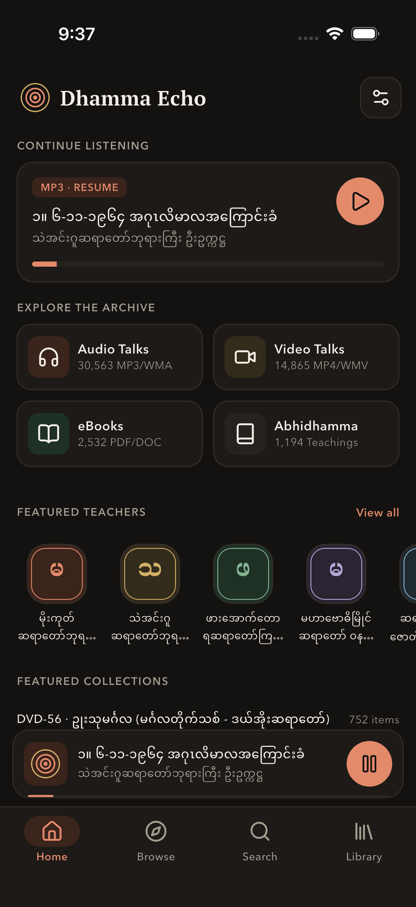
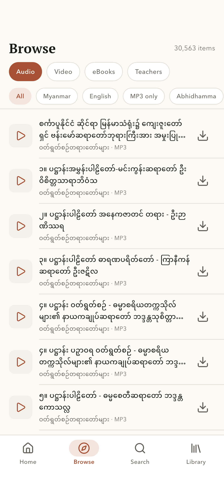
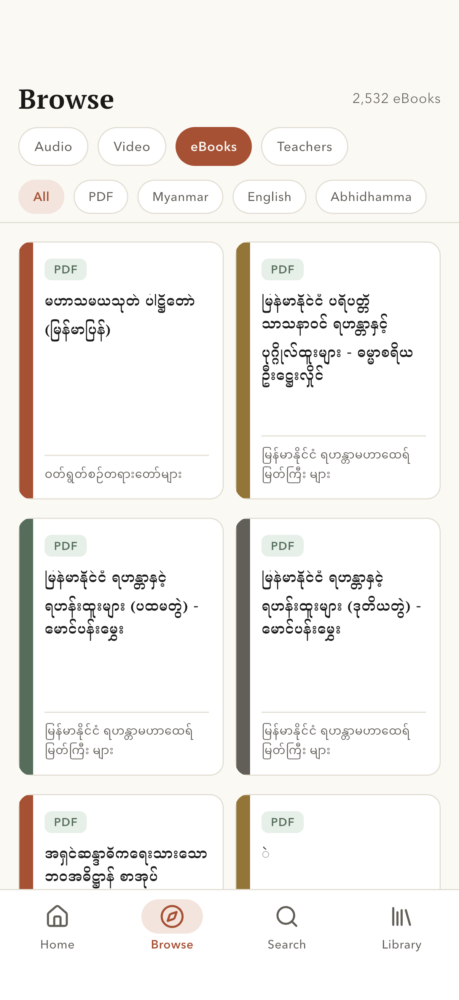
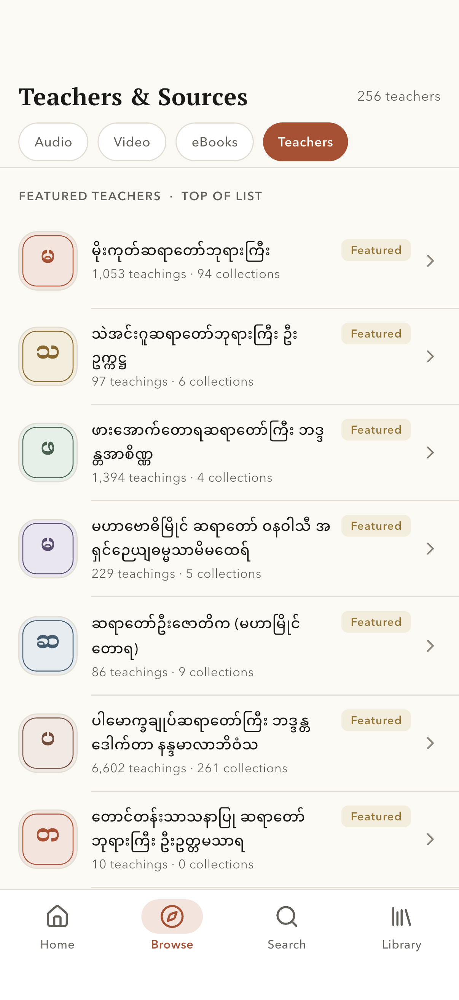
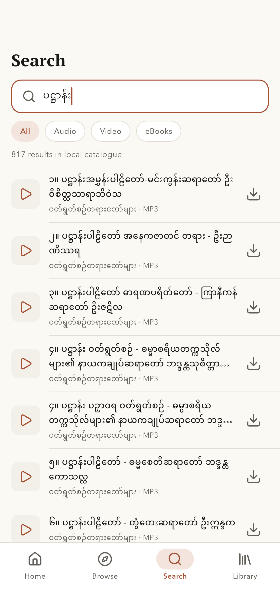
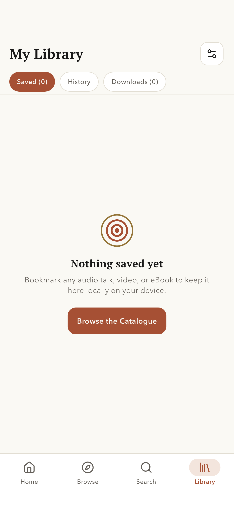
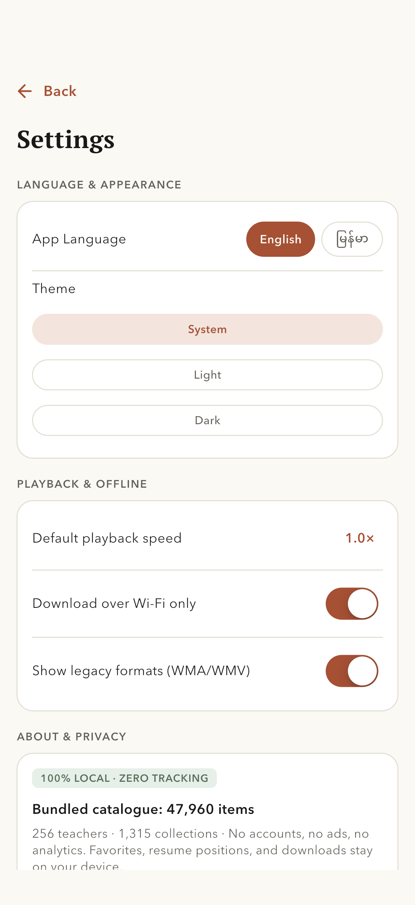

# Dhamma Echo

A calm, local-first Android and iOS library for discovering, listening to, watching, and reading **47,960** authentic Dhamma teachings (MP3 audio, MP4 video, PDF eBooks, plus browser fallback for legacy WMA/WMV/DOC) across **256** teachers and **1,315** collections—with zero accounts, zero ads, and zero tracking.

## Screenshots (iOS · 1206×2622)

| Home | Browse | eBooks | Teachers |
|---|---|---|---|
|  |  |  |  |

| Search | Library | Settings |
|---|---|---|
|  |  |  |

## Highlights

- **Bagan Manuscript Design System:** Light (*Raw Cotton*) and Dark (*Warm Obsidian*) themes with bilingual English / Myanmar (`မြန်မာ`) UI and script-aware typography (`PT Serif`, `Noto Serif Myanmar`, `Noto Sans Myanmar`). See [DESIGN.md](DESIGN.md).
- **Audio (30,563 items):** Background playback with OS lock-screen/notification controls (`just_audio` + `audio_service`), persistent mini-player, queue drawer, ±15s skip, `0.75×–2.0×` speed, sleep timer (`Off / 15m / 30m / 45m / End`), and resume tracking.
- **Video (14,865 items):** Foreground MP4 player with portrait & fullscreen landscape modes, ±15s skip, speed control, resume tracking, and related talks.
- **eBooks (2,532 items):** Built-in PDF reader (`pdfrx`) with Light / Sepia / Dark reading tints, page scrubber, page-number resume, and remote download progress.
- **Offline Downloads & Search:** Instant offline SQLite catalogue search, single-item and bulk series downloads with Wi-Fi-only guard, and app-private storage management.

## Development

```sh
# Boot iOS Simulator and run the app
make dev

# Run on Android emulator or a specific device
make dev-android
make dev DEVICE=<device-id>

# Format, analyze, and run all unit & widget tests
make check

# Platform builds
make build-ios
make build-android
```

Run `make help` to see all targets.

## License

Dhamma Echo is licensed under the [GNU Affero General Public License
v3.0](https://www.gnu.org/licenses/agpl-3.0.html). See the [LICENSE](LICENSE)
file for the complete license text.
