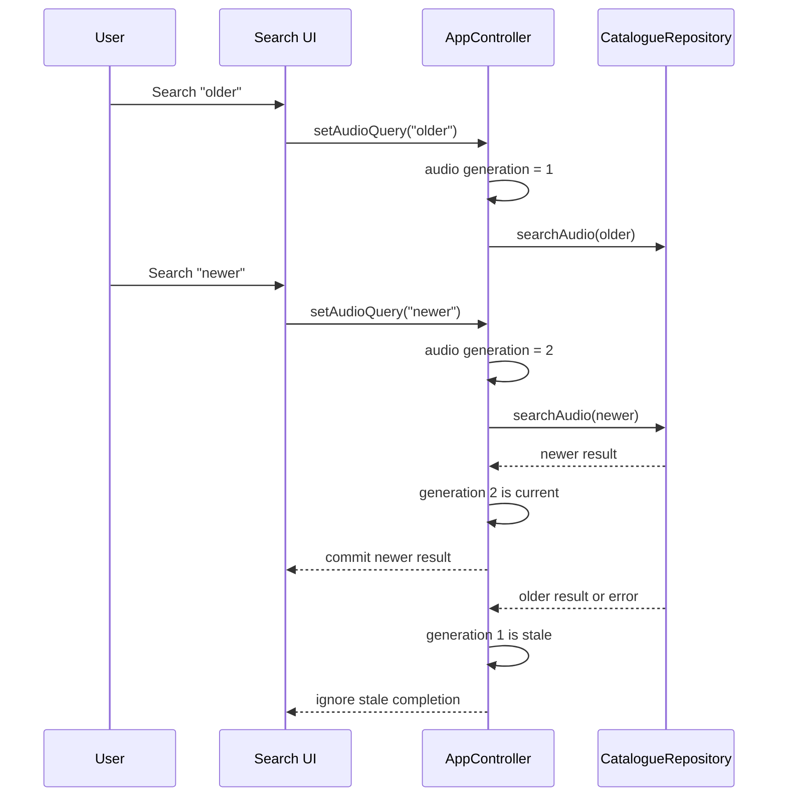
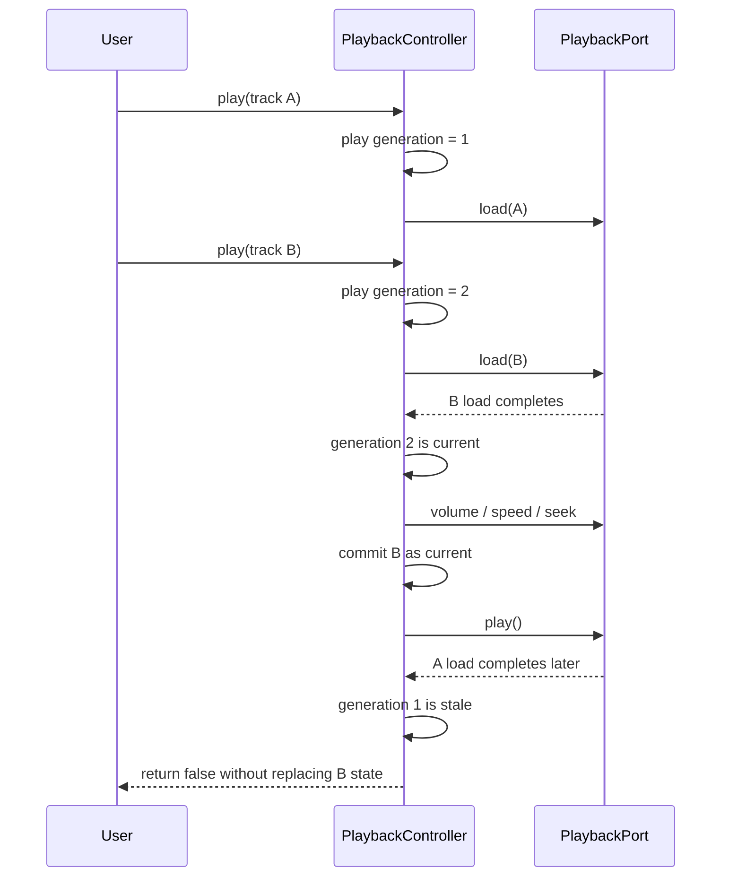

# Async Request Concurrency

Dhamma Echo uses small generation counters instead of a cancellation framework. A request may still finish at the repository or playback-port boundary, but only the newest request is allowed to commit controller state.

## Search requests

Audio, collection, and teacher searches maintain independent generations so unrelated search surfaces do not invalidate one another. Clearing teacher search also advances its generation, preventing an older network/database completion from restoring stale results.

## Playback requests

Generation checks run after asynchronous preparation boundaries. This complements `just_audio`'s own source-load cancellation behavior while keeping product state deterministic at the controller boundary.
