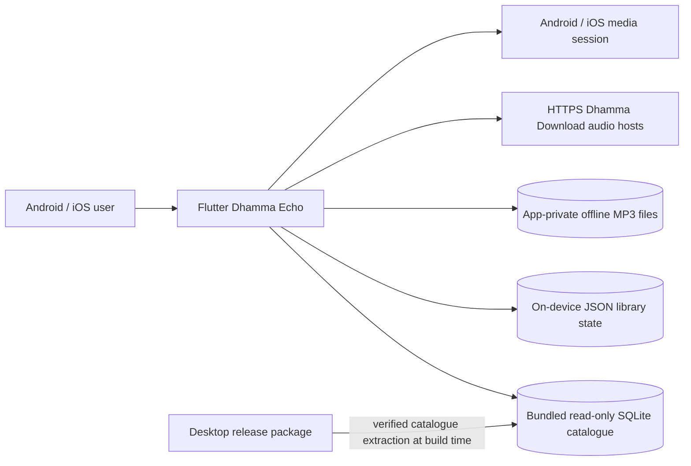

# System Context

Trust boundaries:

- Catalogue text is untrusted data and is never executed.
- Stream/download URLs are accepted only through the explicit Dhamma Download host allowlist.
- Downloads do not follow redirects and become visible only after complete atomic local promotion.
- Personal library state and offline media never leave the device.
- Background media controls operate on the same single in-app audio player; no account or remote-control service is introduced.
