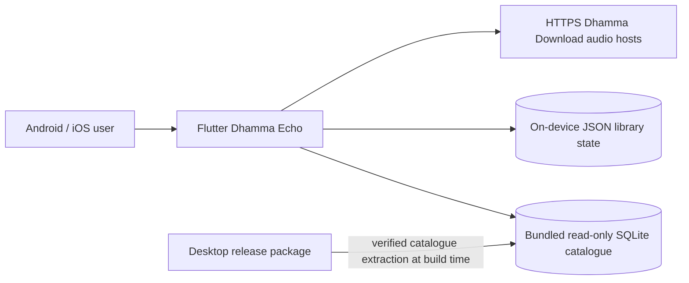

# System Context

Trust boundaries:

- Catalogue text is untrusted data and is never executed.
- Playback URLs are accepted only through the explicit Dhamma Download host allowlist.
- Personal library state never leaves the device.
