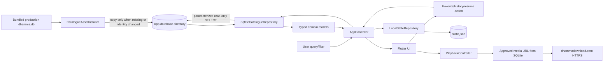

# Catalogue and Library Data Flow

The catalogue is immutable application data and is opened read-only. Search, teachers, collections, categories, formats, languages, titles, and media URLs all come from SQLite. Runtime network access is confined to approved audio playback. Personal state is separate from the catalogue and is sanitized before an atomic temporary-file rename.
