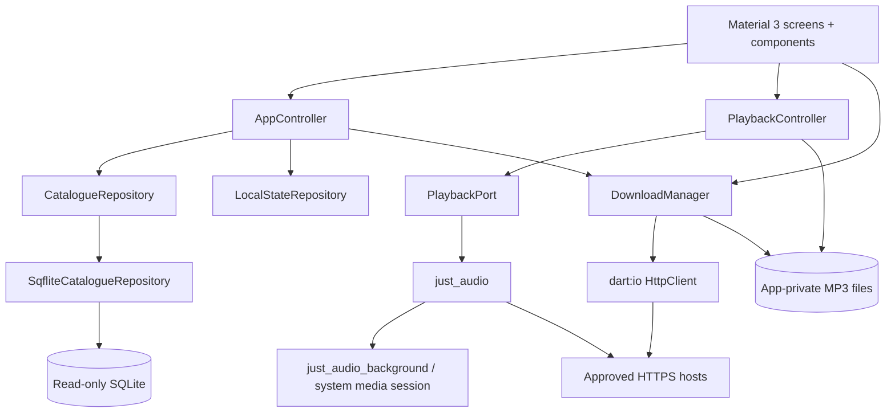

# Module Architecture

- `domain/`: immutable product models.
- `core/`: text normalization, catalogue policy, and media URL trust policy.
- `data/`: SQLite catalogue reads and bounded local state persistence.
- `downloads/`: allowlisted atomic offline-download state and `dart:io` adapter.
- `player/`: playback policy/state plus the `just_audio`/background-media adapter.
- `app/`: application orchestration and top-level Material 3 shell.
- `ui/`: mobile screens and reusable presentational components.
