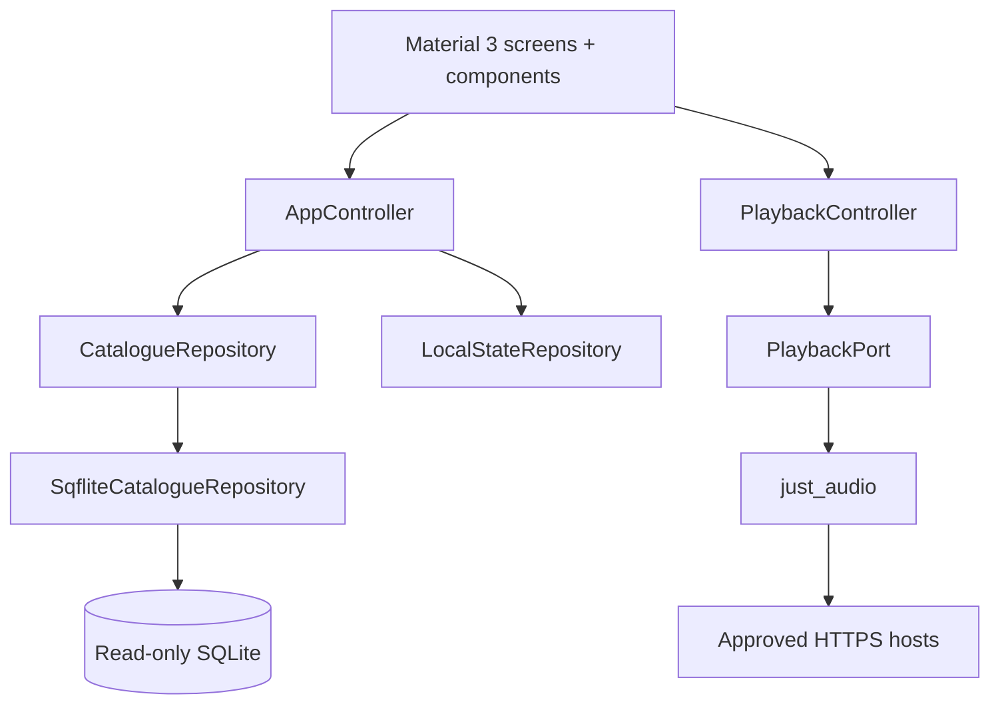

# Module Architecture

- `domain/`: immutable product models.
- `core/`: text normalization, catalogue policy, and media URL trust policy.
- `data/`: SQLite catalogue reads and bounded local state persistence.
- `player/`: playback policy/state plus a narrow `just_audio` adapter.
- `app/`: application orchestration and top-level Material 3 shell.
- `ui/`: mobile screens and reusable presentational components.
