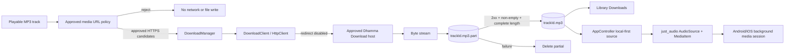

# Background Playback and Offline Downloads

Trust and lifecycle rules:

- Only media accepted by `mediaUrlCandidates` can reach the downloader.
- HTTP catalogue URLs are normalized to HTTPS before download.
- Redirect following is disabled at the `HttpClientRequest` boundary.
- A completed file is never exposed until the temporary stream is closed and validated.
- App-private storage avoids shared-storage permissions and keeps offline media scoped to Dhamma Echo.
- If a local file cannot be loaded, playback falls back only to the existing approved remote candidates.
