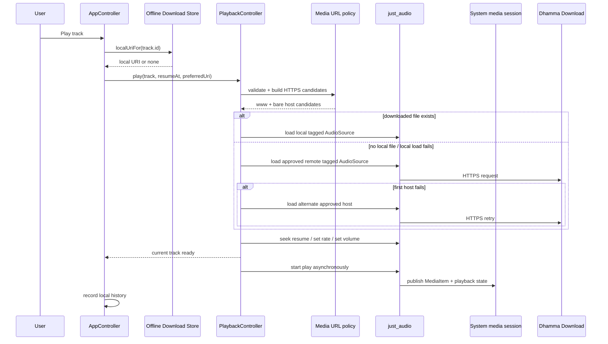

# Playback Sequence

`AudioPlayer.play()` is intentionally not awaited as the definition of "playback started" because its future stays alive until playback later pauses, stops, or completes. UI state is established after source preparation and before the long-lived play future is observed asynchronously.
