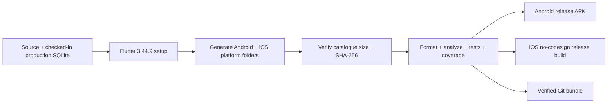

# Build and Release Flow

The production catalogue gate verifies SHA-256 `d88cfda6d761d0e682dac3bf29ab3b1d7019496a114defe057bfc55a6e746d31` and exact byte length `27,750,400`. CI verifies the checked-in database instead of downloading catalogue data during a build. `make catalogue` is reserved for an intentional catalogue refresh.
